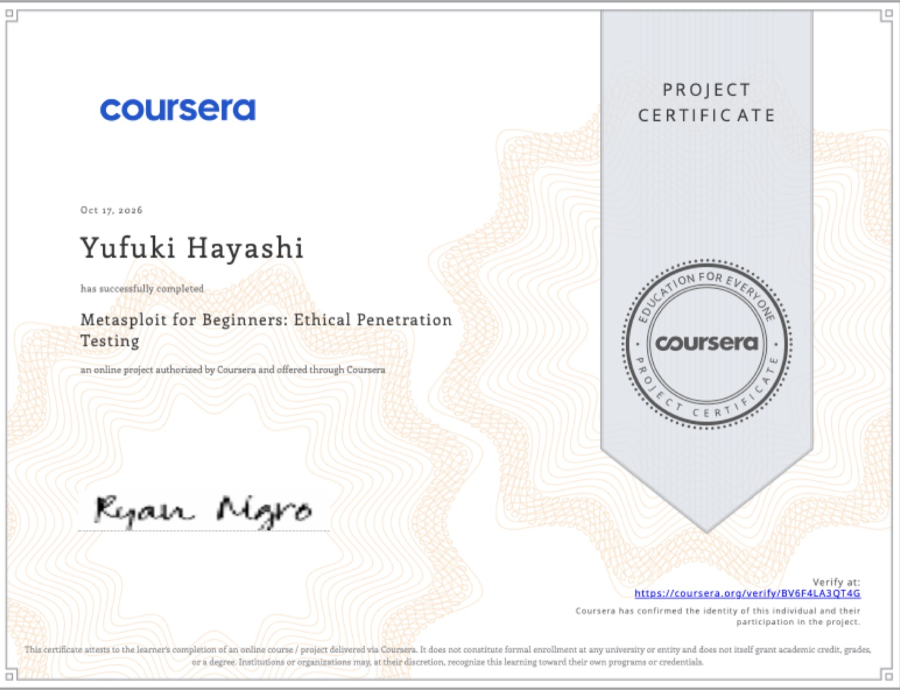
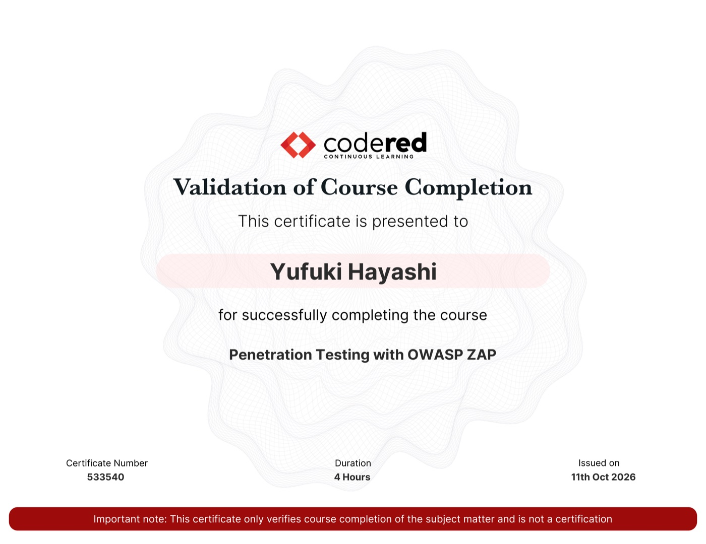

<!-- ===== Header ===== -->
<picture>
  <source media="(prefers-color-scheme: dark)" srcset="assets/banner-dark.svg">
  
</picture>

  Remote @ Japan IT company &nbsp;·&nbsp; Building a startup &amp; an NPO &nbsp;·&nbsp; Cat lover

  <a href="#tech-stack">Tech Stack</a> &nbsp;·&nbsp;
  <a href="#certificates">Certificates</a> &nbsp;·&nbsp;
  <a href="#featured-projects">Projects</a>

<!-- ===== About ===== -->
## About me

Hi! I'm a full-stack developer working remotely in Japan.
I'm preparing to launch a startup and an NPO. Feel free to reach out anytime!

<!-- ===== Tech Stack ===== -->
## Tech Stack

<table>
  <tbody>
    <tr>
      <td nowrap><b>AI</b></td>
      <td>   </td>
    </tr>
    <tr>
      <td nowrap><b>Web</b></td>
      <td>    </td>
    </tr>
    <tr>
      <td nowrap><b>Mobile</b></td>
      <td>  </td>
    </tr>
    <tr>
      <td nowrap><b>Desktop</b></td>
      <td> </td>
    </tr>
    <tr>
      <td nowrap><b>Backend</b></td>
      <td>    </td>
    </tr>
    <tr>
      <td nowrap><b>Cloud</b></td>
      <td nowrap> </td>
    </tr>
    <tr>
      <td nowrap><b>Design</b></td>
      <td></td>
    </tr>
  </tbody>
</table>

<!-- ===== Certificates ===== -->
## Certificates

<table>
  <tr>
    <td align="center" valign="top" width="33.3%">
       
      <b>Harvard University</b> CS50's Introduction to Programming with Python
    </td>
    <td align="center" valign="top" width="33.3%">
       
      <b>Stanford Online</b> Introduction to Statistics
    </td>
    <td align="center" valign="top" width="33.3%">
       
      <b>University of Glasgow</b> MBA Essentials
    </td>
  </tr>
</table>

<b>Latest:</b> Metasploit for Beginners: Ethical Penetration Testing — Coursera (Oct 2026)

### Security

<table>
  <tr>
    <td align="center" valign="top" width="33.3%">
       
      <b>Metasploit for Beginners: Ethical Penetration Testing</b> Coursera · Oct 2026 <code>Security</code>
    </td>
    <td align="center" valign="top" width="33.3%">
       
      <b>Penetration Testing with OWASP ZAP</b> CodeRed · Oct 2026 <code>Security</code>
    </td>
    <td align="center" valign="top" width="33.3%">
       
      <b>Google Cybersecurity</b> Google · Coursera <code>Security</code>
    </td>
  </tr>
</table>

### Other

<table>
  <tr>
    <td align="center" valign="top" width="25%">
       
      <b>Introduction to Model Context Protocol</b> Anthropic <code>AI</code>
    </td>
    <td align="center" valign="top" width="25%">
       
      <b>Claude Code in Action</b> Anthropic <code>AI</code>
    </td>
    <td align="center" valign="top" width="25%">
       
      <b>Claude Code: Software Engineering with Generative AI Agents</b> Vanderbilt University · Coursera <code>AI</code>
    </td>
    <td align="center" valign="top" width="25%">
       
      <b>Foundation: Introduction to LangGraph</b> LangChain Academy <code>AI</code>
    </td>
  </tr>
  <tr>
    <td align="center" valign="top" width="25%">
       
      <b>RAG with MongoDB</b> MongoDB <code>AI</code>
    </td>
    <td align="center" valign="top" width="25%">
       
      <b>Google AI Essentials</b> Google · Coursera <code>AI</code>
    </td>
    <td align="center" valign="top" width="25%">
       
      <b>Generative AI: Prompt Engineering Basics</b> IBM · Coursera <code>AI</code>
    </td>
    <td align="center" valign="top" width="25%">
       
      <b>Meta Front-End Developer</b> Meta · Coursera <code>Web</code>
    </td>
  </tr>
  <tr>
    <td align="center" valign="top" width="25%">
       
      <b>Meta React Native</b> Meta · Coursera <code>Mobile</code>
    </td>
    <td align="center" valign="top" width="25%">
       
      <b>TypeScript Essential Training</b> LinkedIn Learning <code>Web</code>
    </td>
    <td align="center" valign="top" width="25%">
       
      <b>Learning Playwright</b> LinkedIn Learning <code>Testing</code>
    </td>
    <td align="center" valign="top" width="25%">
       
      <b>AWS Cloud Technical Essentials</b> AWS · Coursera <code>Cloud</code>
    </td>
  </tr>
  <tr>
    <td align="center" valign="top" width="25%">
       
      <b>Google Project Management</b> Google · Coursera <code>Business</code>
    </td>
    <td align="center" valign="top" width="25%">
       
      <b>Foundations of Digital Marketing and E-commerce</b> Google · Coursera <code>Business</code>
    </td>
  </tr>
</table>

  
  
  
  

<!-- ===== Projects ===== -->
## Featured Projects

<table>
  <tr>
    <td align="center" valign="top" width="33.3%">
      
       <b>Satellite Tracker</b> 
      2023 · Cesium · 人工衛星等位置情報システム 
      <a href="https://youtu.be/c9HJ10EBNec?si=lKOkCZmxAxKmSODU">Watch demo ↗</a>
    </td>
    <td align="center" valign="top" width="33.3%">
      
       <b>Facebook clone</b> 
      Dec 2021 · React · Node.js · Express · MySQL 
      <a href="https://youtu.be/Hv_jddjDjfA?si=5CK6LI77pCsOoNLp">Watch demo ↗</a>
    </td>
    <td align="center" valign="top" width="33.3%">
      
       <b>TikTok clone</b> 
      Dec 2021 · React Native 
      <a href="https://youtu.be/J2nUzPpPBzY?si=nDHINI8q7yqVTDqf">Watch demo ↗</a>
    </td>
  </tr>
</table>

  
<b>Satellite Tracker — about the data</b>

This system is built upon TLE (Two-Line Element Set) data provided by Space-Track.org, an official service managed by the United States Air Force (USAF) and the United States Space Command (USSPACECOM).
本システムは、アメリカ空軍およびアメリカ宇宙コマンドが管理する公式サービス Space-Track.org が提供する TLE データを基に構築されています。

  
<b>Example Project (Gallery)</b>

